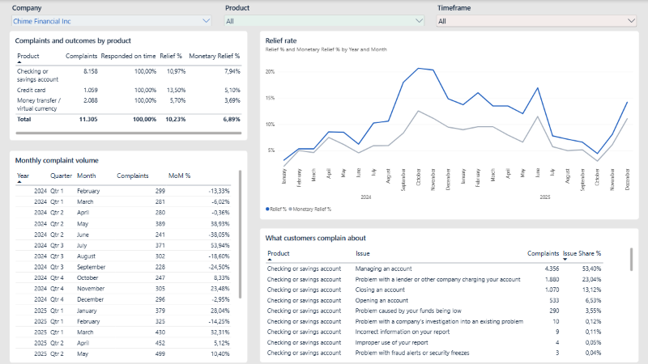
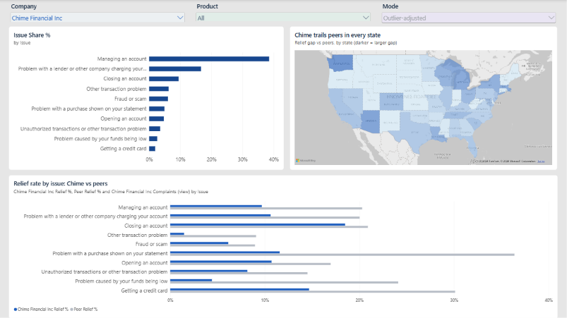
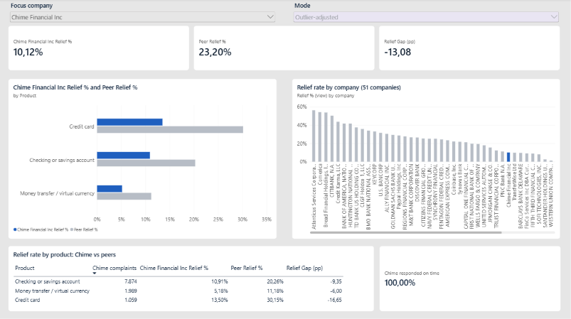

# Where do customers complain, and where does Chime fall behind its peers?

A portfolio project in Python, SQL and Power BI, based on 404,353 US consumer complaints from the CFPB database (credit cards, checking and savings accounts, and money transfer, Jan 2024 – Dec 2025).

**Stakeholder:** The Head of Complaints & Customer Operations at a fintech company. 
**Case study:** Chime Financial Inc; however, the report itself works for any of the 54 companies with at least 500 complaints.

## Main finding

Chime Financial Inc responds to every complaint on time, but only about 10% of its complaints end in relief for the customer, against about 23% at its peers (outlier-adjusted view). The gap holds in all three products, in all 30 states with at least 100 Chime complaints, and it is widest for the product "Money Transfer, Virtual Currency, or Money Service". The data shows where the gap is, not why it exists. The full write-up is in the [findings memo](docs/06_findings_memo.md).

## The report

Three pages, built in Power BI from a star schema:

| Overview | Root Causes | Focus vs Peers |
|---|---|---|
|  |  |  |

- [PDF of the report](powerbi/cfpb_report.pdf)
- [.pbix file](https://github.com/nataliapoulakida/complaints-root-cause-analysis-cfpb/releases/tag/v1.0) (download from the release, opens in Power BI Desktop)
- [How to read the report](docs/05_report_guide.md)

## How it was built

1. **Data pipeline (Python):** combine six CFPB exports, profile and clean them, and build the star schema. Every cleaning decision is logged in the [data-quality log](docs/02_data_quality_log.md).
2. **KPIs (SQL, DuckDB):** volume, relief rate, issue mix and focus company vs peers in [`sql/01_kpis.sql`](sql/01_kpis.sql), with results in `sql/results/`.
3. **Model and measures (Power BI):** a [star schema](docs/03_model.md) and [DAX measures](docs/04_measures.md), including an outlier-adjusted mode that leaves out unusual months.

## What the report can and cannot say

- Complaints are self-reported and are not a random sample of customers.
- There are no customer counts, so the report compares rates between companies and does not show complaint rates per customer.
- A low relief rate can reflect the mix of complaints as well as how they are handled.
- There is no response date, so only the timely flag is used.
- Full list: [project brief](docs/01_brief.md).

## Repository contents

| Folder | Contents |
|---|---|
| `python/` | Numbered scripts: combine, profile, clean, run SQL, build model |
| `sql/` | KPI queries and their results |
| `powerbi/` | PDF export of the report (the .pbix is in the release) |
| `screenshots/` | Report pages and the data model |
| `docs/` | Scope, brief, data-quality log, model, measures, report guide, findings memo, data dictionary |

## Reproducing it

1. Install Python 3.9+ and run `pip install -r requirements.txt`.
2. Download the six CFPB exports (three products × two years, received 1 Jan 2024 – 31 Dec 2025) into a `data/` folder in the project.
3. Run the scripts in order: `python python/01_combine_raw.py`, then `02_profile.py`, `03_clean.py`, `04_run_sql.py` and `05_build_model.py`.
4. Open the .pbix from the release, or rebuild the model from `data/model/` using the [model guide](docs/03_model.md).

The [data dictionary](docs/07_data_dictionary.md) describes every table and column.

## Data

CFPB Consumer Complaint Database, public data, downloaded 14 Oct 2026. The data is not included in this repository.

---
Natalia Poulakida
