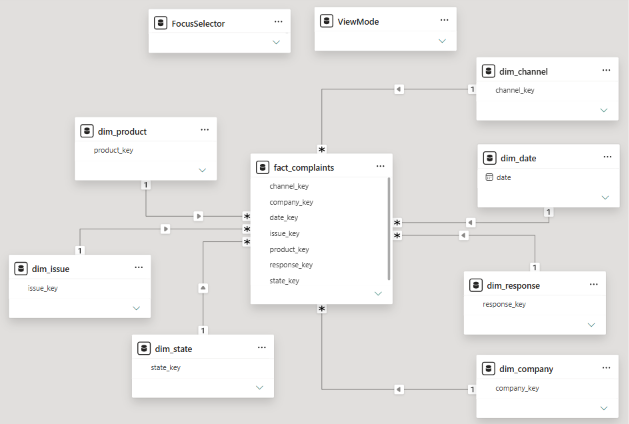

# Data model (star schema)

The report runs on a star schema: one fact table with one row per complaint, surrounded by lookup tables ("dimensions"). The tables are built by `python/05_build_model.py` into `data/model/`.

| Table | Rows | One row per | Key |
|---|---|---|---|
| fact_complaints | 404,353 | complaint | complaint_id |
| dim_date | 731 | calendar day, 1 Jan 2024 to 31 Dec 2025 | date |
| dim_product | 15 | product + sub-product | product_key |
| dim_issue | 99 | issue + sub-issue | issue_key |
| dim_company | 1,087 | company (with type and size) | company_key |
| dim_state | 62 | state | state_key |
| dim_channel | 4 | way the complaint was submitted | channel_key |
| dim_response | 5 | way the company closed it | response_key |

All seven relationships are one-to-many, from the lookup table (one side) to the fact table (many side), single direction.

## Helper tables
Two small tables are created inside Power BI and are deliberately not connected to the fact table. They feed the report's controls and the measures read their selected value:

| Table | Purpose |
|---|---|
| ViewMode | One column, `Mode`, with two values: "Outlier-adjusted" and "All months". The Mode slicer reads it, and the measures decide from it whether flagged months are excluded. |
| FocusSelector | One column, `Focus company`, a calculated table built from `dim_company` that keeps banks, fintechs and similar companies with at least 500 complaints (51 companies, the same set as the company ranking). The Focus company slicer reads it. Because it is not related to `dim_company`, choosing a company does not filter the peer side of the comparison. |

The measures that use them are described in `04_measures.md`.
